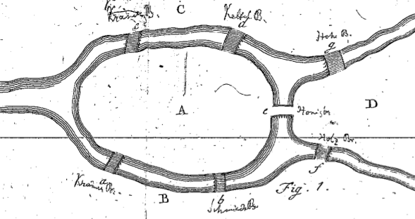
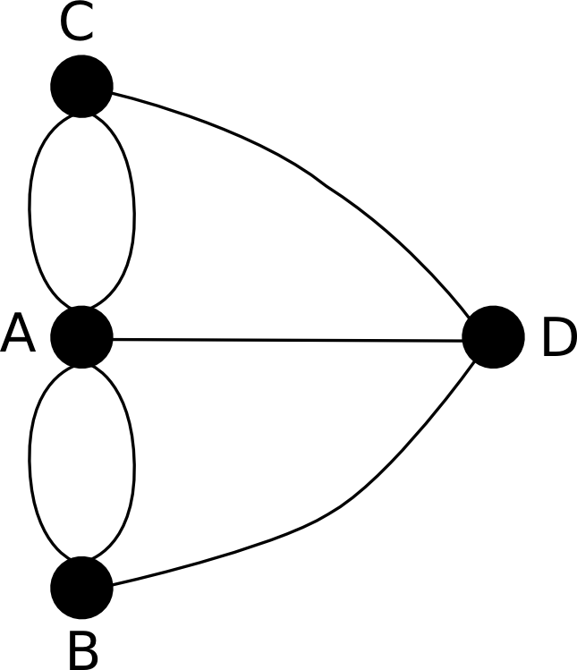
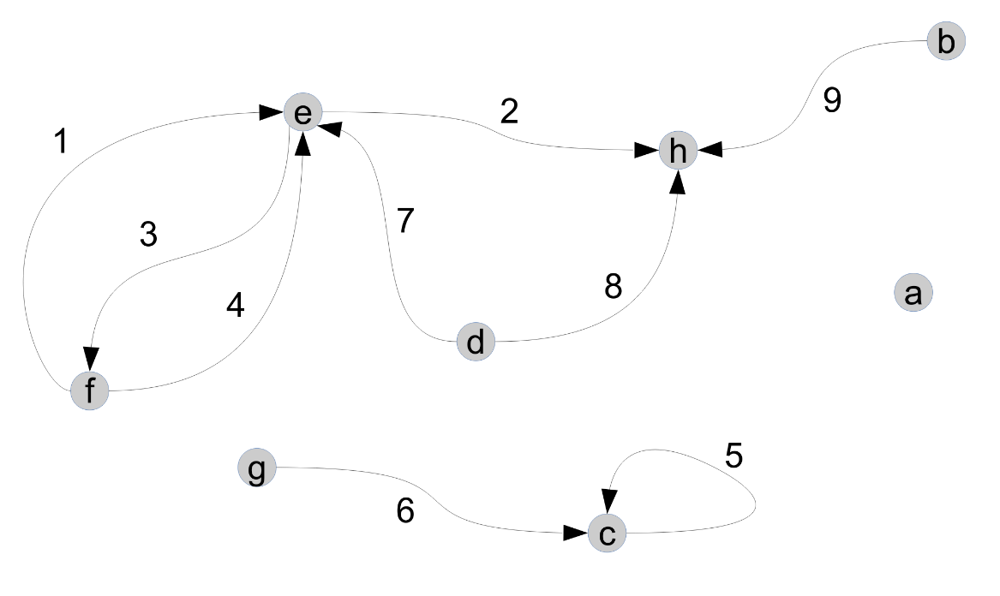
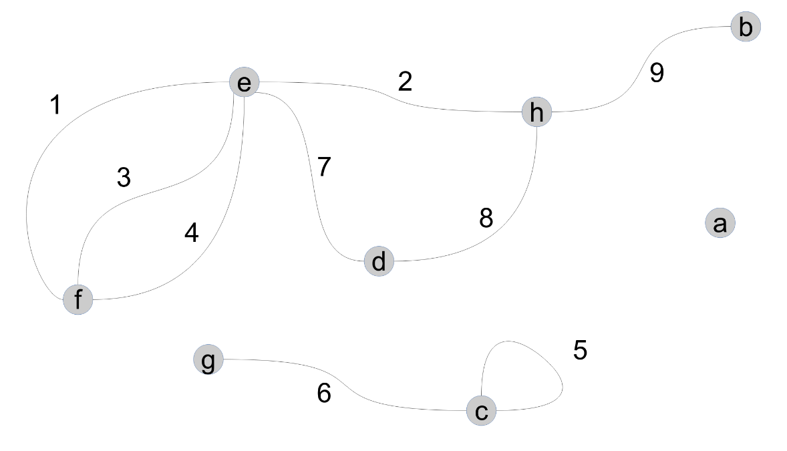
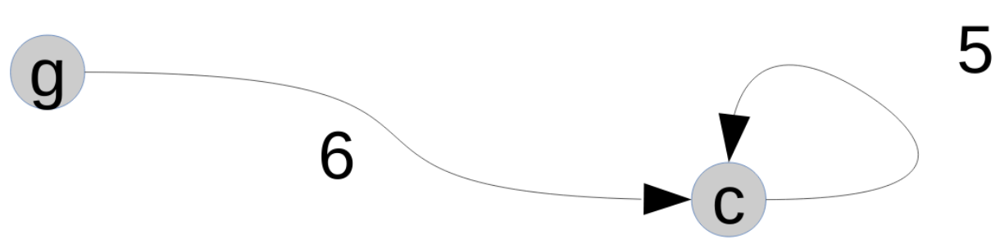
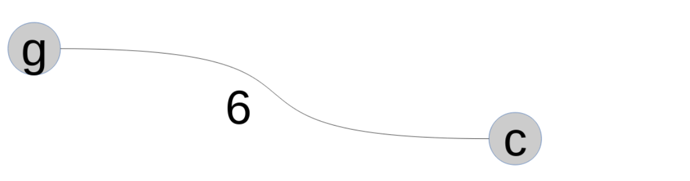
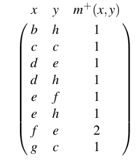
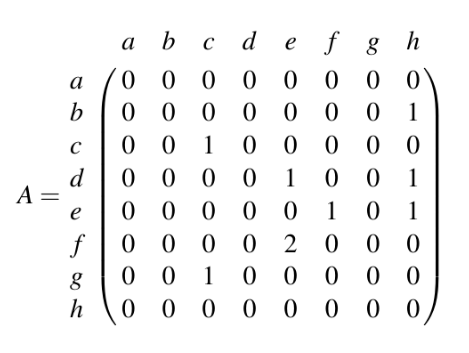
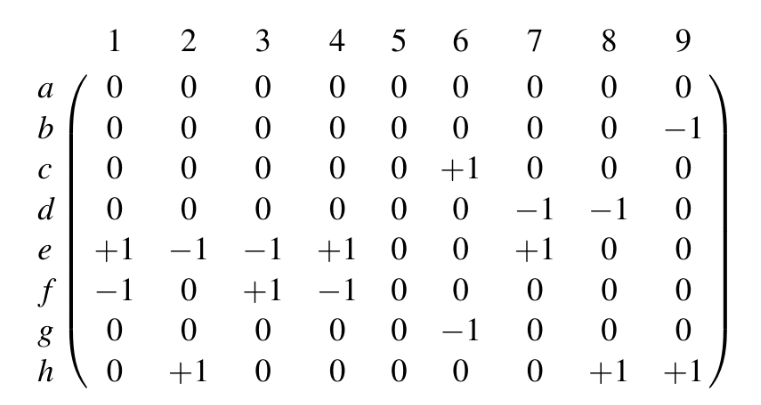
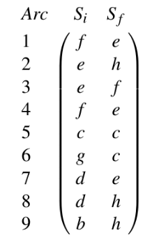

# Éléments de Théorie des Graphes

Si vous voulez approfondir le cours, vous pouvez lire le [cours de Théorie des Graphes de Benoît Costes](5.b_Cours_tdg.pdf) qui va beaucoup plus loin que cette page (qui en est un extrait).

## Un bref historique des graphes

La théorie des graphes est généralement rattachée au problème des sept ponts de Königsberg. En 1736, Leonhard Euler représente les rives et les îles par des sommets et les ponts par des liens. Il montre qu'il est impossible de parcourir chacun des sept ponts exactement une fois.

*Le plan historique de Königsberg et ses ponts.*

*Les lieux sont représentés par des sommets et les ponts par des arêtes.*

Le problème du cavalier sur l'échiquier est étudié au XVIIIe siècle. Au XIXe siècle, Arthur Cayley travaille sur les arbres et James Joseph Sylvester introduit le terme « graphe » en 1878. Le premier ouvrage entièrement consacré à la théorie des graphes est publié par Dénes Kőnig en 1936. Claude Berge contribue ensuite à structurer et diffuser la discipline, notamment avec ses ouvrages d'introduction et ses travaux sur les graphes parfaits et les hypergraphes. Le problème des quatre couleurs est démontré par Kenneth Appel et Wolfgang Haken en 1976.

Les graphes servent aujourd'hui à modéliser des réseaux et leurs relations : réseaux de transport ou de communication, relations sociales, et bien d'autres structures.

## Premières définitions

### Définition intuitive d'un graphe

Un graphe est une structure composée de sommets, qui représentent des objets, et de liens entre ces sommets. Le dessin choisi pour représenter les sommets et les liens n'est pas essentiel : ce sont les relations entre sommets qui définissent le graphe. Deux dessins différents peuvent donc représenter le même graphe.

Dans la suite, on emploie « arc » pour un lien orienté et « arête » pour un lien non orienté. Le PDF emploie parfois « arc » au sens général.

### Graphe orienté

Un graphe orienté est noté `G = (V, E)`, où `V` est l'ensemble des sommets et `E` un ensemble de couples ordonnés de sommets. Un arc `a = (x, y)` part de `x` et arrive en `y`. L'ordre compte : la présence de `(x, y)` n'implique pas celle de `(y, x)`. On peut aussi noter l'arc `xy`.

*Les flèches indiquent le sens des arcs; le graphe contient aussi une boucle et des arcs multiples.*

### Graphe non orienté

Un graphe non orienté est également noté `G = (V, E)`, mais les liens n'ont pas de direction. Une arête reliant `x` et `y` est identique à celle reliant `y` et `x` : l'ordre des extrémités ne compte pas. Dans une représentation graphique, les arcs sont dessinés avec des flèches et les arêtes sans flèches.

*Les arêtes ne portent pas de flèche; ce graphe comporte également une boucle et des arêtes multiples.*

### Ordre d'un graphe

L'ordre d'un graphe fini est le nombre de ses sommets, c'est-à-dire le cardinal de `V`, noté `|V|`.

#### Relations entre les éléments d'un graphe

##### Relations entre les sommets d'un graphe

Pour un arc `a = (x, y)`, `y` est un successeur de `x` et `x` un prédécesseur de `y`. Les deux sommets sont voisins ou adjacents. On note `Γ⁺(x)` l'ensemble des successeurs de `x`, `Γ⁻(x)` celui de ses prédécesseurs, et `Γ(x) = Γ⁺(x) ∪ Γ⁻(x)` l'ensemble de ses voisins. Un sommet ayant un seul voisin est dit pendant.

##### Relations entre les sommets et les arcs d'un graphe

Les sommets reliés par un arc en sont les extrémités. Pour un arc orienté `(x, y)`, `x` est l'extrémité initiale (ou origine) et `y` l'extrémité finale (ou destination). L'arc est sortant de `x` et entrant en `y`. Un arc pendant est incident à un sommet pendant.

Une boucle est un arc dont les deux extrémités sont le même sommet, de la forme `(x, x)`.

*La boucle est orientée vers son sommet.*

*Une boucle non orientée est une arête qui revient au même sommet.*

##### Relations entre les arcs d'un graphe

Deux arcs sont adjacents lorsqu'ils ont au moins une extrémité commune.

#### Multiplicité et degré

La multiplicité d'une paire de sommets `(x, y)` est le nombre d'arcs allant de `x` vers `y`. On la note `m⁺_G(x, y)`; la multiplicité dans le sens inverse est `m⁻_G(x, y) = m⁺_G(y, x)`. La multiplicité totale est la somme des deux. Pour une boucle, la convention du cours compte deux incidences au sommet.

*Une représentation condensée indique chaque paire de sommets et le nombre d'arcs qui la relient.*

Le demi-degré sortant `d⁺_G(x)` est le nombre d'arcs ayant `x` pour extrémité initiale; le demi-degré entrant `d⁻_G(x)` est le nombre d'arcs ayant `x` pour extrémité finale. Le degré total est `d_G(x) = d⁺_G(x) + d⁻_G(x)`. Une boucle contribue deux au degré total.

### Graphe partiel

Si `A` est un sous-ensemble des arcs `E`, le graphe partiel correspondant est `G' = (V, A)`. Il conserve tous les sommets de `G`, mais ne garde que les arcs de `A`; les sommets qui n'ont alors plus d'arcs incidents restent présents et deviennent isolés.

### Graphe et sous-graphe connexes

Un sous-graphe induit par un ensemble `X` de sommets conserve les sommets de `X` et tous les arcs de `G` dont les deux extrémités appartiennent à `X`. Un sous-graphe partiel résulte de la combinaison de ces opérations : on choisit des sommets, puis éventuellement une partie seulement des arcs entre eux.

Une chaîne relie deux sommets si elle permet de passer de l'un à l'autre en suivant des arêtes de proche en proche. Un graphe est connexe si toute paire de sommets est reliée par une chaîne. Cette définition ignore l'orientation des arcs; pour un graphe orienté, on parle de connexité forte lorsque chaque sommet peut atteindre chaque autre en suivant le sens des arcs.

La relation « être égal ou être relié par une chaîne » est une relation d'équivalence sur les sommets. Les sous-graphes induits par ses classes d'équivalence sont les composantes connexes. Le nombre de composantes est le nombre de connexité; le graphe est connexe si et seulement si ce nombre vaut un.

## Modes de représentation d'un graphe

### Matrice d'adjacence

Pour un graphe d'ordre `n`, la matrice d'adjacence est une matrice carrée `n × n`, dont les lignes et les colonnes correspondent aux sommets. Le coefficient en ligne `i`, colonne `j` est le nombre d'arcs allant du sommet `i` au sommet `j`.

La matrice représente les boucles sur sa diagonale. Pour un graphe non orienté, elle est symétrique; l'absence de boucle se traduit par une diagonale nulle. La somme de la ligne `i` donne le demi-degré sortant du sommet `i`, et la somme de la colonne `j` son demi-degré entrant. La puissance `k` de cette matrice permet aussi de compter les parcours de longueur `k` entre deux sommets, en considérant chaque arc de longueur un.

*Les lignes et les colonnes suivent l'ordre des sommets `a` à `h`; la valeur `2` signale deux arcs de `f` vers `e`.*

### Matrice d'incidence

Pour un graphe orienté sans boucle, la matrice d'incidence a `n` lignes (les sommets) et `m` colonnes (les arcs). Pour chaque arc, le coefficient vaut `-1` au sommet initial, `+1` au sommet final et `0` pour les autres sommets.

Pour un graphe non orienté, le coefficient vaut `1` si le sommet est une extrémité de l'arête et `0` sinon; une boucle est représentée par `2` au sommet concerné. Avec la convention orientée `-1/+1`, une boucle orientée ne peut pas être représentée correctement, car ses deux contributions s'annulent.

*Chaque colonne correspond à un arc numéroté; `-1` marque son origine et `+1` sa destination.*

## Matrice SIF

La matrice SIF (« Sommets Initiaux et Finaux ») représente un graphe par une matrice de taille `m × 2`. Chaque ligne correspond à un arc; la première colonne indique son sommet initial et la seconde son sommet final. Cette représentation condensée évite les grandes matrices d'adjacence ou d'incidence lorsque la plupart de leurs coefficients sont nuls.

*Les arcs numérotés sont décrits par leur sommet initial `Si` et leur sommet final `Sf`.*
